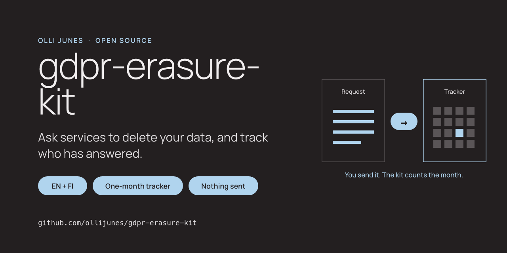
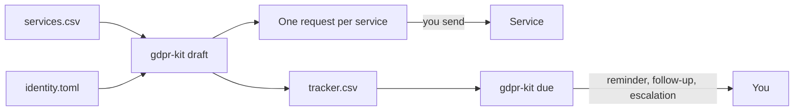

# gdpr-erasure-kit



[](https://github.com/ollijunes/gdpr-erasure-kit/actions/workflows/ci.yml)
[](pyproject.toml)
[](pyproject.toml)
[](SECURITY.md)
[](LICENSE)

Ask services to delete your data, or to show you what they hold, and keep
track of who has answered.

The kit has request templates in English and Finnish for erasure (GDPR
Article 17) and access (Article 15), a tracker for the one-month deadline,
and a small command-line tool. You give the tool a list of services. It writes
one request per service and a tracker file. You read each draft and send it
yourself.

[Deadlines and reminders](docs/deadlines.md) · [Määräajat suomeksi](docs/maaraajat.md) ·
[Google Sheets](docs/google-sheets.md) · [Security](SECURITY.md) ·
[Contributing](CONTRIBUTING.md) · [ollijunes.com](https://ollijunes.com)



## Who it is for

People who want to clean up their accounts across many services, or find out
what a company knows about them, without writing every letter from scratch
or losing track of deadlines. It is useful when you leave a service, after a
data breach, or when you start getting marketing from companies you have
never dealt with.

## What is in the kit

| Part | Where |
| --- | --- |
| Erasure request, Article 17, English and Finnish | [templates/en/erasure.txt](gdpr_erasure_kit/templates/en/erasure.txt), [templates/fi/erasure.txt](gdpr_erasure_kit/templates/fi/erasure.txt) |
| Access request, Article 15, English and Finnish | [templates/en/access.txt](gdpr_erasure_kit/templates/en/access.txt), [templates/fi/access.txt](gdpr_erasure_kit/templates/fi/access.txt) |
| Tracker template (CSV) | [tracker/tracker-template.csv](tracker/tracker-template.csv) |
| How the deadline is counted, reminders, escalation | [docs/deadlines.md](docs/deadlines.md), [docs/maaraajat.md](docs/maaraajat.md) |
| The same rules as spreadsheet formulas | [docs/google-sheets.md](docs/google-sheets.md) |
| Command-line tool | `gdpr-kit draft`, `gdpr-kit due`, `gdpr-kit deadline` |

You can use the templates by hand. Copy one, replace the `${...}` fields and
send it. The tool only saves you the copying when the list is long.

## Quick start

Install with [pipx](https://pipx.pypa.io/) or [uv](https://docs.astral.sh/uv/):

```sh
pipx install git+https://github.com/ollijunes/gdpr-erasure-kit
# or
uv tool install git+https://github.com/ollijunes/gdpr-erasure-kit
```

1. Create a private folder for your own files, outside any shared or synced
   folder.
2. Copy [examples/identity.example.toml](examples/identity.example.toml) to
   `identity.toml` in that folder and fill in your name and the email address
   your accounts use. Postal address and other identifiers are optional; add
   only what a service needs to find you.
3. Copy [examples/services.example.csv](examples/services.example.csv) to
   `services.csv` and list the services. Take each privacy contact from the
   service's own privacy notice. A row can override the request type or the
   language.
4. Write the drafts:

```sh
gdpr-kit draft --services services.csv --identity identity.toml --out drafts
```

The output folder must be new or empty. It gets one text file per service and
a `tracker.csv`:

```text
drafts/
  01-cloud-pebble-erasure-en.txt
  02-paper-lantern-erasure-en.txt
  03-blue-acorn-erasure-fi.txt
  04-copper-meadow-access-en.txt
  05-quiet-comet-erasure-en.txt
  tracker.csv
```

5. Read every draft. Remove anything that does not apply to that service.
   Send it from the email address your account uses, or paste it into the
   service's privacy form.
6. Write the date you sent each request in `sent_on` and set `status` to
   `sent`. If you send them all today, `--mark-sent` does this for you when
   you create the drafts.
7. Check what needs action:

```sh
gdpr-kit due --tracker drafts/tracker.csv
```

```text
Cloud Pebble | sent | reminder | 2026-11-15
Copper Meadow | identity_requested | waiting for your identity reply | 2026-10-20
```

Run it once a week until every row is `completed`, `refused` or `escalated`.

Use `--type access` for access requests and `--lang fi` for Finnish. To check
a single date:

```sh
gdpr-kit deadline --received 2026-08-31
```

```text
2026-09-30
One calendar month from receipt; weekends move to Monday; public holidays are not checked.
```

## Deadlines

A controller must answer within one month of receiving your request. It can
extend by two further months if it tells you why within the first month. The
kit counts calendar months the way the European Data Protection Board does:
5 March becomes 5 April, 31 August becomes 30 September, and a deadline on a
weekend moves to Monday.

The tracker also gets three action dates: a reminder five days before the
deadline, a follow-up the day after it, and an escalation date two weeks
later. If a controller asks you to prove who you are, the count waits until
you answer. [Deadlines and reminders](docs/deadlines.md) explains each rule
and its source.

## Privacy

Your identity file, services list, drafts and tracker show which services you
use. They stay in files you control.

- The tool opens no network connections and sends nothing. A test runs every
  command with sockets disabled.
- On Linux and macOS, output files are created with mode `600` in a folder
  with mode `700`. Existing files are never overwritten.
- Errors name the file and the row, never the value in it.
- Tracker cells that a spreadsheet could run as a formula are written as text.

The [security model](SECURITY.md) lists what this protects and what it does
not.

## Limitations

- This is not legal advice. The templates follow the GDPR text and the EDPB
  guidelines, but a service may have a legitimate reason to keep some data,
  for example accounting records. The erasure template asks the service to
  say what it keeps and why.
- GDPR applies to organisations in the EU and EEA, and to organisations
  elsewhere that offer goods or services to people there or monitor their
  behaviour (Article 3). A service outside its reach may ignore a request. The UK has its own, similar law; the templates do not cite it.
- The tool does not find your accounts for you, check that a contact address
  is real, or read replies.
- Public holidays are not in the deadline count. A deadline on a holiday
  moves to the next working day; check your own calendar.
- Deadlines are counted from the date you send. A letter by post arrives
  later, so its real deadline is a few days later too.
- Only English and Finnish templates are included. Corrections and other
  languages are welcome; see [CONTRIBUTING.md](CONTRIBUTING.md).

## FAQ

Does the tool send the emails?
No. You read and send each request yourself. That is deliberate: a request
that goes out unread can contain the wrong account or the wrong service.

Should I send a copy of my passport?
Usually no. A controller may ask for what it needs to confirm your identity,
and the request must be proportionate. Writing from the email address that
is registered to your account is often enough. The templates say so.

Can I ask for access first and erasure later?
Yes. An access request shows what a service holds, and an erasure request
can then remove it. Use `--type access` first, and a second run with
`--type erasure` and a new output folder later.

What if the service does not answer?
Follow up once in writing, then complain to a supervisory authority. In
Finland that is the [Data Protection Ombudsman](https://tietosuoja.fi/en/home).
See [When the answer does not come](docs/deadlines.md#when-the-answer-does-not-come).

## Development

```sh
uv sync --locked
uv run python -m pytest --cov=gdpr_erasure_kit --cov-fail-under=90
uv run ruff check .
uv run ruff format --check .
python3 scripts/check_public_tree.py
```

Tests use invented people and services on example domains and temporary
folders. CI runs Linux, macOS and Windows with Python 3.11 to 3.14 and scans
the full Git history with Gitleaks and a privacy checker. See
[CONTRIBUTING.md](CONTRIBUTING.md).

## License

[MIT](LICENSE). Made by [Olli Junes](https://ollijunes.com). This is an
independent project, not affiliated with any data protection authority.
